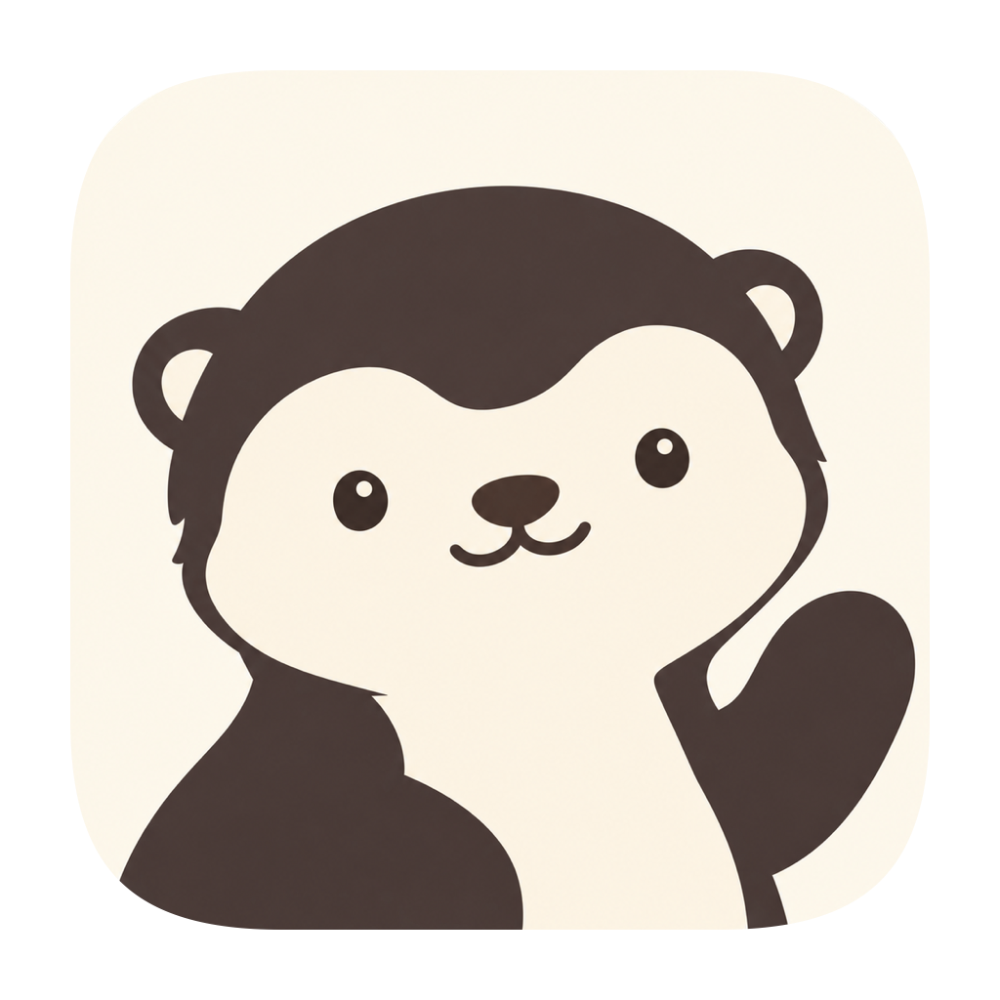

<div align="center">
  

  <h1>Daban</h1>

  <p><strong>你的 AI 搭子，也有自己的电脑。</strong></p>

  <p>
    <a href="LICENSE"></a>
    <a href="https://github.com/murongg/daban/actions/workflows/ci.yml"></a>
    <a href="https://github.com/murongg/daban/actions/workflows/native-desktop.yml"></a>
    <a href="#当前进度"></a>
    <a href="#如何开始"></a>
    <a href="https://www.electronjs.org/"></a>
    <a href="https://www.typescriptlang.org/"></a>
    <a href="https://github.com/murongg/daban/stargazers"></a>
  </p>

  <p>Daban 是基于 DeepSeek Harness 的桌面 AI 工作区。你可以和 Bot 聊天、查资料、处理文件，也可以让它使用独立的 Linux 桌面，操作浏览器、终端和其他应用。需要时，随时接管它的屏幕。</p>

  <p>目前处于早期预览阶段。Apple 芯片 Mac 支持 Linux 虚拟机和本机桌面两种模式；Windows x64 提供本机桌面模式。</p>

  <p>
    使用说明：<a href="docs/zh-CN/README.md">简体中文</a> · <a href="docs/en/README.md">English</a> · <a href="docs/README.md">文档首页</a>
  </p>
</div>

## 能做什么

- **从一个搭档开始**：在 Bot 广场选择预设，或创建自己的 Bot，设置职责、模型和工作偏好。
- **自由选择模型**：连接 DeepSeek、Claude、Gemini 等供应商，加载模型列表、测试调用，自动匹配上下文和图片能力，查看推理、工具调用等能力声明；为工作区和每个 Bot 选择合适的模型。
- **聊天，也能做事**：搜索资料、写作、处理文档和数据；普通任务直接使用工具，需要图形界面时再连接电脑。
- **各有屏幕，共享环境**：多个 Bot 各自操作独立桌面，共用工作文件、已安装的软件和浏览器登录状态。
- **也能使用你的电脑**：在 macOS 或 Windows 上授权 Bot 操作主显示器中的真实应用；一次一位 Bot，返回 Daban 或按 Ctrl + Alt / Option + Esc 即可暂停。
- **随时接管**：查看执行过程，接管某个 Bot 的电脑，处理完再交还；其他 Bot 可以继续工作。
- **积累工作上下文**：为 Bot 保存偏好、资料、便笺和技能，继续处理之前的工作。内置 find-skills，支持在对话中查找并确认安装技能。
- **协作与定时执行**：让多个 Bot 在群聊中协作，管理共享待办，安排定时任务。

普通查询和计算可自动执行；Linux 虚拟机内安装软件、删除文件等高风险命令会请求确认。虚拟机中的软件、独立屏幕和共享浏览器登录属于 Mac 的虚拟机模式。本机模式使用当前用户的真实桌面，不具备虚拟机隔离，也不自动提权。

## 如何开始

使用已打包的客户端时：

1. 打开 Daban，按引导下载基础运行组件。首次使用不需要安装虚拟机。
2. 继续跟随引导选择供应商、填写 API Key 并选择模型，验证保存后点击「开始使用」进入工作区。之后可在设置中修改。
3. 从 Bot 广场添加一个搭档，或创建自己的 Bot，开始对话。
4. 需要操作应用时，为 Bot 连接电脑；需要人工操作时，点击接管。

界面支持简体中文和 English，可在「设置 → 通用 → 界面语言」即时切换。首次安装页也提供语言选择，设置只保存在当前设备。

基础运行组件会自动下载并缓存在本机，无需另外安装 Docker、Node.js 或 DSH。首次下载只包含后台、Node.js 和 DSH；Lima 工具、Linux 执行程序与系统镜像在从电脑面板或「设置 → 运行环境」安装 Linux 电脑时才下载，并缓存复用。Mac 的 Linux 环境首次安装建议预留 40 GB 可用磁盘空间。Windows 本机模式以聊天和桌面操作为主，尚不提供独立 Linux 桌面及工作区命令工具。PDF 和 Office 文档解析需要 Linux 工作区；没有 Linux 时仍可使用文本与图片。

连接 Linux 工作区后，Bot 可按需加载内置 Office 技能，生成和编辑 Word、Excel、PowerPoint，进行 PDF 导出、公式重算和图片预览。所需依赖缺失时，会沿用软件安装审批；支持图片输入的模型可读取工作区预览图，纯文本模型只报告实际完成的内容和数据检查。

程序和 Linux 环境运行在本机，模型请求会发送到你配置的供应商，API 用量由你自己的账户承担。退出客户端后，已启动的后台任务仍可继续，本机桌面控制会断开；电脑休眠或关机期间无法持续执行。

## 开发与预览

只想查看和调整 UI，可以先运行网页预览：

```sh
npm ci
npm run dev:web
```

打开 <http://127.0.0.1:5173>。网页预览用于界面开发，不会执行真实模型任务。

完整 Electron 客户端的运行、环境准备和打包方式见 [开发指南](docs/development.md)。

## 当前进度

本地 Agent、独立 Linux 桌面、共享浏览器登录、人工接管和命令审批已接入。macOS 发行包使用 Developer ID 签名并通过 Apple 公证，客户端支持检查更新。

当前优先完善桌面客户端。云端执行、手机端和跨设备上下文同步列入后续计划。

遇到问题或有建议，欢迎提交 [Issue](https://github.com/murongg/daban/issues)。

## 开源协议

Copyright © 2026 Daban contributors. 除另有说明外，本项目代码采用 [GNU Affero General Public License v3.0 only（AGPL-3.0-only）](LICENSE)。第三方代码、依赖和品牌资源保留各自的许可证与声明。
